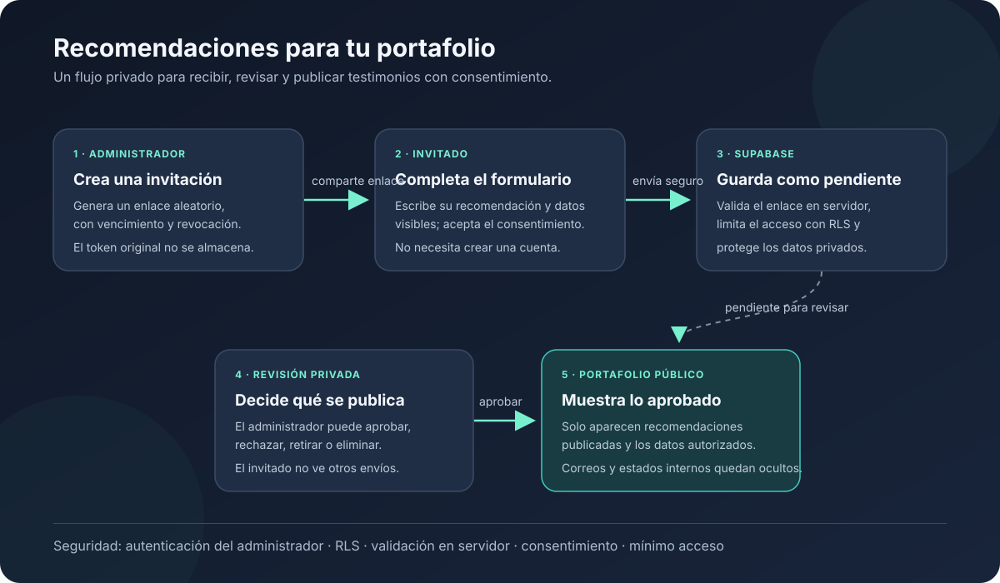

# Diseño de testimonios y recomendaciones

Este documento describe cómo añadir al portafolio una sección de recomendaciones y un flujo privado para solicitarlas, revisarlas y publicarlas. **Es una guía de implementación, no una funcionalidad ya desplegada.** El sitio actual es una aplicación React/Vite estática publicada en Vercel y todavía no tiene panel de administración ni base de datos.

## Objetivo

1. Mostrar en el portafolio únicamente recomendaciones aprobadas.
2. Permitir que el propietario cree un enlace de invitación privado desde el panel.
3. Permitir que el invitado complete un formulario sencillo desde ese enlace.
4. Guardar cada envío como pendiente de revisión; nunca publicarlo automáticamente.
5. Dejar que el propietario publique, rechace o elimine el envío.

Los proyectos y trabajos existentes seguirán siendo el catálogo de proyectos. La sección de testimonios se añade como contenido independiente y no reemplaza ni duplica los proyectos.

## Diagrama del flujo

## Arquitectura propuesta

| Parte | Responsabilidad |
|---|---|
| React + Vite en Vercel | Portafolio público, formulario de invitación y panel de administración |
| Supabase Auth | Inicio de sesión del propietario |
| Supabase Postgres | Invitaciones y recomendaciones |
| Row Level Security (RLS) | Limitar el acceso a los datos desde la API pública de Supabase |
| Supabase Edge Functions | Crear invitaciones y aceptar recomendaciones con validación en servidor |

El navegador usa la URL del proyecto Supabase y la clave `anon`/publishable, que no es un secreto. La clave `service_role` solo se configura como secreto de las Edge Functions y nunca se incluye en el frontend, el repositorio ni variables `VITE_*`.

## Distribución de pantallas y rutas

Se conserva el idioma en el primer segmento de la URL, como en las rutas existentes:

| Ruta | Acceso | Pantalla |
|---|---|---|
| `/:lang/` | Público | Inicio; contiene la sección `#testimonios` entre proyectos y contacto |
| `/:lang/recommend/:token` | Invitado con enlace | Formulario para enviar una recomendación |
| `/:lang/admin/login` | Público | Inicio de sesión del propietario |
| `/:lang/admin/testimonials` | Propietario autenticado | Panel para gestionar enlaces y recomendaciones |

`lang` es `es`, `en` o `pt`. Las etiquetas y mensajes se traducen con los archivos de `src/i18n/locales/`; el segmento `recommend` y las rutas del panel se mantienen estables para no depender de traducciones en el router. La URL del invitado es un token de acceso: no se debe incluir en sitemap, navegación pública, analítica ni logs evitables.

El inicio, la lista de proyectos y los testimonios públicos conservan el layout del sitio. El formulario del invitado debe ser una página enfocada en la tarea y sin acceso a las herramientas administrativas. El panel tiene navegación y estados propios, pero mantiene la identidad visual del portafolio.

### Sección pública

- Ancla estable `#testimonios`, título y breve introducción.
- Tarjetas de recomendaciones publicadas: texto, nombre y, si fueron aprobados para publicación, cargo/organización y contexto del trabajo.
- No renderizar correos, tokens, estados internos, identificadores privados ni recomendaciones pendientes/rechazadas.
- Si no hay recomendaciones publicadas, ocultar la sección o presentar un estado vacío definido por diseño; nunca mostrar contenido de prueba como si fuera real.

### Panel de administración

El panel requiere sesión válida y verifica permisos también en el backend. La protección de una ruta en React solo mejora la experiencia: no sustituye la autorización del servidor.

Vista propuesta:

1. **Invitaciones:** crear enlace, ver fecha de vencimiento/estado, copiarlo, revocarlo y generar otro.
2. **Pendientes:** leer el envío completo y publicar, rechazar o eliminar.
3. **Publicadas:** revisar lo visible y retirar una recomendación o eliminarla.
4. **Cerradas/expiradas:** identificar enlaces usados, vencidos o revocados.

Tras crear un enlace, mostrar su URL completa una sola vez con un botón para copiar y una advertencia para compartirla directamente con la persona indicada. No mostrar el token original otra vez desde la base de datos.

## Formulario de recomendación

Campos recomendados:

| Campo | Requerido | Tratamiento |
|---|---:|---|
| Nombre | Sí | Se muestra al publicar, sujeto a revisión |
| Cargo o profesión | No | Se muestra solo si el propietario lo aprueba |
| Empresa u organización | No | Se muestra solo si el propietario lo aprueba |
| Trabajo o relación profesional | No | Puede venir prellenado por la invitación; se revisa antes de publicar |
| Recomendación | Sí | Texto plano, con límite sugerido de 1.500 caracteres |
| Correo de contacto | No | Solo para uso privado; nunca se publica |
| Consentimiento | Sí | Confirmación explícita de que el texto puede revisarse y publicarse con los datos visibles indicados |

El formulario debe validar en cliente para dar feedback inmediato y repetir todas las validaciones en servidor: longitudes, campos requeridos, formato del correo si se solicita, invitación válida y consentimiento. Tras el envío muestra confirmación de recepción y aclara que la recomendación espera aprobación. No debe permitir elegir el estado `published`.

Un token vencido, revocado o ya utilizado muestra un mensaje localizado y no acepta otro envío. El invitado no necesita crear una cuenta ni puede ver otros envíos.

## Modelo de datos sugerido

### `recommendation_invites`

- `id`: identificador interno UUID.
- `token_hash`: hash del token aleatorio; no guardar el token original.
- `created_by`: usuario administrador que creó el enlace.
- `created_at`, `expires_at`: fechas de creación y expiración.
- `revoked_at`: nulo mientras siga activo.
- `used_at`: nulo mientras no se haya enviado una recomendación.
- `context`: contexto opcional para el trabajo, sin información confidencial.

### `recommendations`

- `id`: identificador interno UUID.
- `invite_id`: invitación utilizada, con restricción que impida más de un envío por invitación.
- `name`: nombre de quien recomienda.
- `role`, `organization`, `work_context`: datos opcionales.
- `email`: opcional y privado; nunca incluido en la consulta pública.
- `body`: texto de recomendación en texto plano.
- `consent_at`: fecha de aceptación del consentimiento.
- `status`: `pending`, `published` o `rejected`.
- `created_at`, `updated_at`, `published_at`: fechas de seguimiento.

Antes de crear las tablas se deben definir migraciones versionadas, restricciones e índices. Los cambios de estado y el consumo de la invitación deben ser operaciones atómicas para evitar que dos solicitudes concurrentes usen el mismo enlace.

## Protección de datos y seguridad

1. **Acceso administrativo:** desactivar el registro público de usuarios en Supabase Auth; crear o autorizar manualmente la cuenta del propietario. Exigir contraseña robusta y activar MFA cuando esté disponible.
2. **Autorización en servidor:** las Edge Functions que crean enlaces verifican el JWT y comprueban que el usuario pertenece a una lista de administradores autorizados. No confiar solo en que la interfaz oculte rutas.
3. **RLS por defecto cerrado:** activar RLS en todas las tablas. El rol anónimo no puede listar invitaciones, consultar recomendaciones privadas ni cambiar estados. El acceso autenticado se limita al administrador.
4. **Lectura pública acotada:** exponer únicamente recomendaciones `published` y exclusivamente los campos públicos. Preferir una vista o función con una lista explícita de columnas; nunca devolver la fila completa.
5. **Tokens de invitación:** generar tokens criptográficamente aleatorios, con suficiente entropía, expiración (30 días como valor inicial recomendado), uso único y revocación. Guardar solo el hash. No guardar tokens en logs, analítica ni errores.
6. **Consumo seguro:** una Edge Function valida el token, su expiración, revocación y uso, valida el formulario y consume la invitación junto con la creación del registro pendiente en una operación atómica. Las credenciales privilegiadas solo viven en el entorno de servidor.
7. **Datos mínimos:** no hacer obligatorio el correo si no se necesita. Informar para qué se guarda, quién lo puede ver, cuánto tiempo se conserva y cómo pedir su eliminación. El correo nunca se publica.
8. **Consentimiento y publicación:** guardar la fecha del consentimiento; solo el propietario publica. Si se edita sustancialmente una recomendación o cambian los datos mostrados, confirmar de nuevo el permiso antes de publicar.
9. **Abuso y validación:** limitar frecuencia y tamaño de solicitudes, validar en servidor, devolver errores genéricos que no revelen tokens válidos y considerar CAPTCHA si aparecen envíos automatizados.
10. **Salida segura:** guardar y mostrar el texto como texto plano, limitando longitud. React escapa texto por defecto; no usar `dangerouslySetInnerHTML` para renderizar recomendaciones.
11. **Transporte y configuración:** usar HTTPS, secretos separados por entorno y acceso mínimo al proyecto Supabase. No incluir credenciales reales en `.env.example`, documentación, capturas ni commits.
12. **Ciclo de vida:** definir un procedimiento para revocar enlaces, retirar contenido publicado y eliminar datos personales bajo solicitud; revisar periódicamente invitaciones vencidas y datos que ya no se necesitan.

La autenticación y RLS son capas complementarias. La clave pública de Supabase no protege datos por sí misma; la protección depende de políticas verificadas en la base de datos y de las comprobaciones en servidor.

## Configuración y despliegue

1. Crear el proyecto Supabase y aplicar migraciones para tablas, restricciones, índices, políticas RLS y funciones necesarias.
2. Crear manualmente el usuario propietario y comprobar el flujo de sesión; no habilitar el registro abierto.
3. Desplegar las Edge Functions y guardar allí los secretos requeridos. Las funciones privilegiadas no deben exponerse como endpoints que acepten operaciones de administrador sin validar la sesión y el rol.
4. Configurar en Vercel las variables públicas del frontend, por ejemplo `VITE_SUPABASE_URL` y `VITE_SUPABASE_ANON_KEY`. Son públicas; nunca poner ahí `service_role`.
5. Mantener el fallback SPA de Vercel para las rutas profundas de los tres idiomas. Verificar que tanto `/es/recommend/<token>` como las rutas `/en/` y `/pt/` cargan la aplicación al abrirse directamente.
6. Asegurar que rutas privadas no se indexen y que los links de invitación no aparezcan en sitemap. No almacenar tokens en parámetros de consulta si el flujo puede usar segmentos de ruta y evitar registrar la URL completa.
7. Probar primero en un proyecto Supabase de desarrollo; revisar RLS con los roles `anon` y autenticado antes de publicar el despliegue de producción.

Los nombres anteriores son una propuesta de configuración, no variables que ya existan en el proyecto. El archivo [vercel.json](../vercel.json) ya tiene rewrites por idioma; se debe confirmar que cubren estas rutas profundas y ajustar la configuración solo si las pruebas del build o el despliegue muestran que hace falta.

## Pruebas de aceptación

- Una persona sin sesión puede enviar un formulario con una invitación vigente, pero no puede listar otros envíos ni modificar estados.
- Un formulario inválido, una invitación vencida/revocada/usada y la falta de consentimiento se rechazan en servidor.
- Reutilizar simultáneamente una invitación produce como máximo una recomendación pendiente.
- El propietario puede crear, copiar y revocar invitaciones, revisar pendientes, publicar, rechazar y eliminar registros.
- Solo recomendaciones `published` aparecen en la consulta pública, sin correos ni campos internos.
- Publicar o retirar un testimonio actualiza la sección pública sin reconstruir el sitio.
- Rutas directas, recarga, idioma, mensajes de error y estados de carga funcionan en español, inglés y portugués.
- Las tablas resisten lecturas y escrituras no autorizadas al probar RLS con las claves/roles correspondientes.
- El build y las pruebas del proyecto pasan; las pruebas de integración cubren el backend, no solo el renderizado del formulario.

## Orden sugerido de trabajo

1. Definir consentimiento, campos y política de retención.
2. Crear proyecto Supabase, migraciones, RLS y usuario administrador.
3. Implementar Edge Functions y probar los permisos antes de conectar la UI.
4. Añadir rutas, formulario de invitación, validación e internacionalización.
5. Añadir panel de administración y estados de revisión.
6. Incorporar la sección pública y sus estilos responsive.
7. Configurar Vercel, ejecutar pruebas de seguridad funcional y publicar.

El portafolio actual no incluye todavía estos componentes ni persistencia en Supabase; cada punto debe implementarse y verificarse antes de considerar disponible el flujo.
